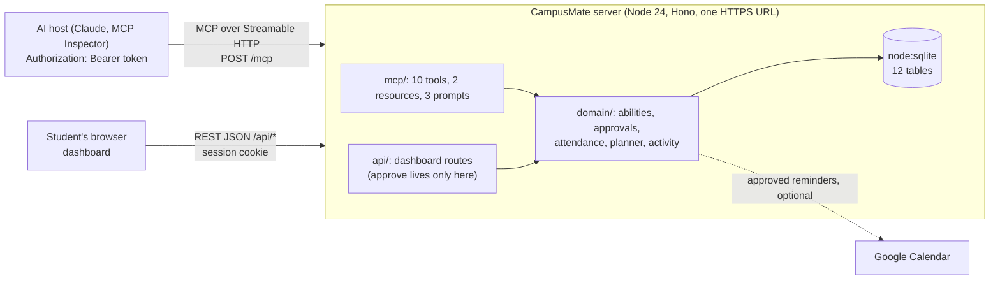

# CampusMate MCP

**Your college life, in your AI assistant, and nothing happens without your yes.**

wHACKiest 2026 · Track 1: **Make MCP Matter**

|                |                                                                                                         |
| -------------- | ------------------------------------------------------------------------------------------------------- |
| Live dashboard | https://campusmate-ulnc.onrender.com (free Render instance: first visit after 15 min idle takes ~1 min) |
| MCP endpoint   | `https://campusmate-ulnc.onrender.com/mcp` (needs the bearer token shown on the Connect page)           |
| Repository     | https://github.com/gtsanjana3-eng/campusmate-mcp                                                        |

> **Status: deployed with demo data.** All 10 MCP tools, 2 resources and 3 prompts work with the
> approval flow behind them, and the dashboard has Today, Approvals, Activity, Permissions and
> Connect pages. The live site passes the checks listed in [docs/testing.md](docs/testing.md).
> Not yet verified on the live site: a session inside Claude itself and the logged-in dashboard
> journeys (verified locally and in the automated end-to-end tests). College data is a seeded demo
> student and emails go to a demo outbox.

## Problem statement

**Track 1, "Make MCP Matter"** (wHACKiest 2026): _"Build an MCP-powered solution a regular person
would actually use every day"_, with useful, reliable and **controlled** interactions with the
apps and tools people already rely on. Our interpretation, for students:

A student's day is spread across the college portal (attendance), WhatsApp groups (notices),
Google Classroom (assignments), email (faculty) and a timetable photo. Deadlines get missed,
attendance shortages are found too late, and writing to faculty takes far too long. AI assistants
could help, but they can't see this data, and students wouldn't trust them to act on their own.

## Solution

CampusMate is an **MCP server** plus a **companion dashboard**, served by one Node process:

- **Reads**: the AI assistant gets today's classes, deadlines, attendance and notices instantly.
- **Proposes**: faculty emails, reminders, new deadlines and "mark as done" become _pending_ cards.
- **The student approves** every action in the dashboard. No MCP tool can approve anything, and
  the AI's token cannot call the dashboard API.

Example: _"Can I skip OS tomorrow?"_ → _"You're at 76.9%. You can miss 1 more class and stay
above 75%."_ The number comes from code, not from the model.

### Key features

| Feature                    | What it does                                                                                                                  |
| -------------------------- | ----------------------------------------------------------------------------------------------------------------------------- |
| 10 MCP tools               | 6 read tools, 4 act tools that only create pending actions ([docs/mcp-tools.md](docs/mcp-tools.md))                           |
| Approval dashboard         | Exact preview, reason, edit (emails), approve with confirmation, reject; 24 h expiry                                          |
| Per-tool permissions       | The student switches any tool off; the AI is refused and the attempt is logged                                                |
| Activity log               | Every read, proposal, refusal and decision, kept for 30 days                                                                  |
| Attendance maths           | `canMiss` / `mustAttend` computed by code, never guessed                                                                      |
| Google Calendar (optional) | Approved reminders can be added to a CampusMate calendar ([docs/integrations.md](docs/integrations.md)); off on the live demo |
| Accessible, responsive UI  | Keyboard and screen-reader support, announcements for new approvals, works from 320 px wide                                   |

## Architecture overview



Full design, request flow and security model: [docs/architecture.md](docs/architecture.md).
Database: [docs/database.md](docs/database.md). AI tool selection: [docs/ai-workflows.md](docs/ai-workflows.md).

## Technology stack

| Layer     | Choice                                                                                 |
| --------- | -------------------------------------------------------------------------------------- |
| Runtime   | Node 24 (runs TypeScript directly), TypeScript 7 strict, npm workspaces                |
| MCP       | Official `@modelcontextprotocol/server` 2.4 + `@modelcontextprotocol/hono` (stateless) |
| Server    | Hono 4, zod 4, built-in `node:sqlite`                                                  |
| Dashboard | React 19, Vite 8, React Router 8, CSS Modules with design tokens                       |
| Quality   | Oxlint, Prettier, Vitest 5, Testing Library, official MCP client in end-to-end tests   |
| Hosting   | Render free web service (`render.yaml`)                                                |

## Repository layout

```
campusmate-mcp/
├── shared/types/   API contract shared by server and dashboard
├── server/         MCP server, REST API, database and static host
│   └── src/        app.ts, index.ts, api/, auth/, config/, data/, domain/, lib/, mcp/, sources/
├── web/            Dashboard (React): pages/, components/, hooks/, services/, layouts/
├── docs/           architecture, MCP tools, AI workflows, integrations, database, testing, deployment, demo
├── render.yaml     Render Blueprint
└── .env.example    Every setting, with placeholders only
```

## Installation and local development

Requires **Node 24+** and npm. No database server is needed.

```bash
git clone https://github.com/gtsanjana3-eng/campusmate-mcp.git
cd campusmate-mcp
npm ci
cp .env.example .env
```

Edit `.env`: replace `MCP_TOKEN`, `SESSION_SECRET` and `DASHBOARD_PASSCODE`. Generate the two
secrets with:

```bash
node -e "console.log(require('node:crypto').randomBytes(32).toString('hex'))"
```

`DASHBOARD_PASSCODE` is the **invite code** for creating dashboard accounts; it needs at least 12
characters and no placeholder words. Optionally set `OWNER_EMAIL` and `OWNER_PASSWORD` for an
account that is recreated at every start. The server refuses to start with placeholder, short or
repetitive values and names the variable at fault.

| Command              | What it does                                                                           |
| -------------------- | -------------------------------------------------------------------------------------- |
| `npm run dev:server` | Server with auto-restart at http://localhost:8787 (MCP at `/mcp`)                      |
| `npm run dev:web`    | Dashboard dev server at http://localhost:5173; proxies `/api` and `/mcp` to the server |
| `npm run build`      | Builds the dashboard into `web/dist`                                                   |
| `npm start`          | Production: one process serves the dashboard, `/api` and `/mcp` on `PORT`              |
| `npm run seed`       | Resets the database to the demo student                                                |

For a production-like run: `npm run build && npm start`, then open http://localhost:8787. Sign in
with the owner account, or choose **Create an account** and enter the invite code. The **Connect** page shows the MCP URL and token for Claude or the MCP
Inspector. The database file (`./data/campusmate.db`) is created and seeded on first start.

Environment variables are documented in [.env.example](.env.example) and
[docs/deployment.md](docs/deployment.md#environment-variables). Never commit `.env`.

## Testing

```bash
npm run check           # lint, format check, type checks, all tests, production build
npm run test:coverage   # coverage for both workspaces
```

Latest results (Phase 17): server 181 tests, web 51 tests, all passing; coverage about 96% of
statements. Details, performance measurements and the live-site checks are in
[docs/testing.md](docs/testing.md).

## Deployment

The repository includes a Render Blueprint. In Render choose **New → Blueprint**, pick this
repository, and set `DASHBOARD_PASSCODE`. Render generates the other secrets. Step-by-step
instructions, free-plan limits and rollback: [docs/deployment.md](docs/deployment.md).

## Known limitations

- **Demo data only:** one seeded student; emails go to a demo outbox, never a real inbox.
- **Free hosting:** the live instance sleeps after 15 minutes idle and starts from fresh demo data
  on every restart (no persistent disk). See the demo-day checklist in
  [docs/deployment.md](docs/deployment.md#demo-day-checklist-free-plan).
- **Login lockout on Render** counts per visitor (`TRUST_PROXY_HOPS=3`, confirmed from the live
  log; see [docs/deployment.md](docs/deployment.md)). It needs re-checking if the hosting changes.
- **Google Calendar** is tested only against a simulated Google; it is off on the live demo.
- **Not yet verified live:** a session inside Claude and the logged-in dashboard journeys.

The full list, with future improvements, is in [docs/testing.md](docs/testing.md#known-limitations-and-future-improvements).

## Contributing

See [CONTRIBUTING.md](CONTRIBUTING.md).
