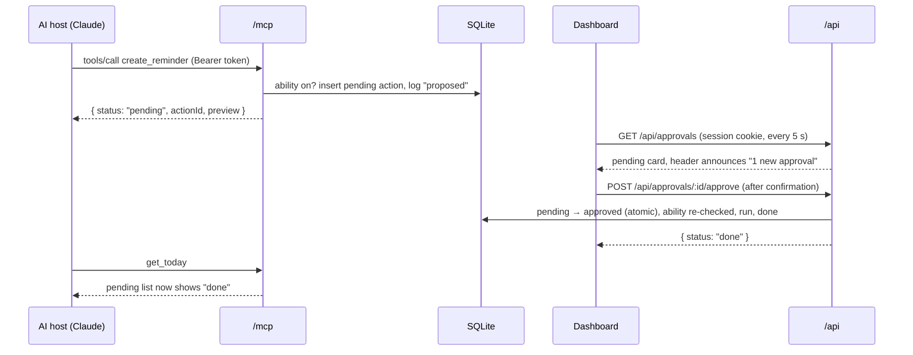

# CampusMate MCP architecture

## The rule everything is built around

**The AI can only propose. Only the student approves.**

Act tools never execute anything; they create a _pending action_. The only code path that executes
an action is `POST /api/approvals/:id/approve`, which requires the dashboard's session cookie. The AI
host only holds the MCP bearer token, which `/api` does not accept. There is no approve tool.

## Diagram

```
 ┌────────────────────────────┐                  ┌────────────────────────────────┐
 │ AI host: Claude / Inspector│                  │ Student's browser: dashboard    │
 │ Connector URL + header:    │                  │ Email + password → httpOnly     │
 │ Authorization: Bearer <tok>│                  │ session cookie                  │
 └─────────────┬──────────────┘                  └───────────────┬────────────────┘
               │ MCP: Streamable HTTP, POST /mcp                 │ REST JSON: /api/* (same origin)
               ▼                                                 ▼
 ┌──────────────────────────────────────────────────────────────────────────────────┐
 │ CampusMate server: one Hono app on Node 24, one public HTTPS URL                 │
 │                                                                                  │
 │  auth/   bearer (/mcp)                session (/api, except POST /api/session)   │
 │  mcp/    10 tools · 2 resources · 3 prompts      api/   dashboard routes          │
 │          (validate → call domain)                      (approve lives ONLY here) │
 │                           ▼                                                      │
 │  domain/ abilities · approvals (pending → approved/rejected/expired) · activity  │
 │          attendance maths · planner · email recipient rules                      │
 │                           ▼                                                      │
 │  sources/ Academic, Mail, Reminders interfaces → mock implementations (MVP)       │
 │                           ▼                                                      │
 │  data/   store.ts → node:sqlite (seeded mock student) · mock outbox              │
 │  static: web/dist with SPA fallback · secure headers                             │
 └──────────────────────────────────────────────────────────────────────────────────┘
```

## Stack

| Layer                | Choice                                                                                                |
| -------------------- | ----------------------------------------------------------------------------------------------------- |
| Runtime and language | Node 24, TypeScript 7 (strict)                                                                        |
| MCP                  | `@modelcontextprotocol/server` 2.4 + `@modelcontextprotocol/hono` 2.0 (stateless, per-request server) |
| HTTP                 | Hono 4 on `@hono/node-server`                                                                         |
| Validation           | zod 4                                                                                                 |
| Database             | built-in `node:sqlite`                                                                                |
| Dashboard            | React 19, Vite 8, React Router 8, CSS Modules + design tokens                                         |
| Quality              | Oxlint, Prettier, Vitest, Testing Library, MCP Inspector                                              |
| Hosting              | Render (free tier, re-seeded on restart); AWS App Runner as backup                                    |

## MCP surface

**Read tools** (run immediately when enabled; every call is logged)

| Tool             | Purpose                                                                                        |
| ---------------- | ---------------------------------------------------------------------------------------------- |
| `get_today`      | Today's classes, what's due in 72 h, attendance alerts, and recent proposals with their status |
| `get_timetable`  | Weekly or daily timetable                                                                      |
| `list_deadlines` | Deadlines by date range or subject                                                             |
| `get_attendance` | Attendance per subject with `canMiss` / `mustAttend` computed by code                          |
| `list_notices`   | Recent notices                                                                                 |
| `plan_week`      | Suggested study blocks in free periods; saves nothing                                          |

**Act tools** (create a pending action only; a `reason` is required)

| Tool                  | Purpose                                                         | Stage |
| --------------------- | --------------------------------------------------------------- | ----- |
| `draft_faculty_email` | Email to a faculty member; recipient always comes from our data | MVP   |
| `add_deadline`        | Add a deadline, usually from a pasted notice                    | MVP   |
| `create_reminder`     | Reminder for a deadline or class                                | MVP   |
| `mark_deadline_done`  | Mark work as submitted                                          | MVP   |

**Resources:** `campusmate://timetable`, `campusmate://rules`.
**Prompts:** `morning_brief`, `weekly_plan`, `write_to_faculty`.

Attendance maths, with `a` attended out of `h` held and minimum `m` (0.75):
`canMiss = floor(a/m − h)` when at or above the minimum, otherwise
`mustAttend = ceil((m·h − a)/(1 − m))`. Seed data: OS at 40/52 (76.9%) → `canMiss = 1`.

## Approval flow

```
 act tool ──► ability enabled? ──no──► refuse + log "blocked"
                 │ yes
                 ▼
        validate + resolve trusted data (e.g. faculty email)
                 ▼
        INSERT pending_action + log "proposed"
                 ▼
  Dashboard card: what / to whom / reason / exact content
     Edit (email only) · Reject · Approve
                                    ▼
        UPDATE … SET status='approved' WHERE id=? AND status='pending'   (atomic)
                                    ▼
        ability still enabled? → execute in a transaction → 'done' + log
        on error → 'failed' + reason + log
 Pending older than 24 h → 'expired'
```

## Security notes

- Bearer token compared in constant time; DNS-rebinding protection from the SDK's Hono app, with
  allowed hosts set from `PUBLIC_URL`.
- Accounts: email + password (scrypt hashes from `node:crypto`, constant-time checks; an unknown
  email takes as long as a wrong password and gets the same message). Sign-up needs the invite code
  (`DASHBOARD_PASSCODE`), because every account sees the one demo student's data. An optional owner
  account (`OWNER_EMAIL`/`OWNER_PASSWORD`) is recreated at every start.
- Session cookie: signed (user id + issue time), httpOnly, Secure, SameSite=Strict, 12-hour
  lifetime; it ends when its account no longer exists, and logging out revokes every earlier
  session on the server. State-changing routes require JSON.
- Login and sign-up: 5 failed attempts (wrong password or invite code) lock that client out for 15
  minutes; 30 failures from anyone pause all logins. The server refuses to start with placeholder, short or repetitive secrets.
- API responses are `Cache-Control: no-store`; request bodies over 16 KB are refused.
- At most 20 proposals can wait at once; history (activity, sent demo emails, past reminders,
  decided actions) is deleted after 30 days.
- zod validation and length limits on every input. React escapes all text; no raw HTML.
- Prompt injection (for example in a notice) can at most produce a pending card the student rejects.
- **Residual risk:** the guarantee is that the _MCP channel_ cannot approve. A browser-automation
  agent driving the student's logged-in dashboard could click Approve. Future mitigation: re-enter
  the passcode before sending email.

## Communication flow



- The dashboard calls `/api` on its own origin (no CORS, no hard-coded URL).
- Each MCP request gets a fresh stateless server instance; there are no MCP sessions to lose.
- An approved reminder is also offered to Google Calendar when connected; the approval answers
  within 2 s even if Google does not, and the result is added as a note.

## Data model (SQLite, 12 tables)

`settings`, `subjects`, `classes`, `attendance`, `deadlines`, `notices`, `reminders`, `outbox`,
`pending_actions`, `activity`, `abilities`, `integrations` (encrypted Google token). All access goes
through `server/src/data/store.ts`. Columns, rules, migrations and backups: [database.md](database.md).

## Assumptions to confirm

- Attendance minimum is 75% (stored in `settings`).
- Single demo student; no OAuth in the hackathon version.
